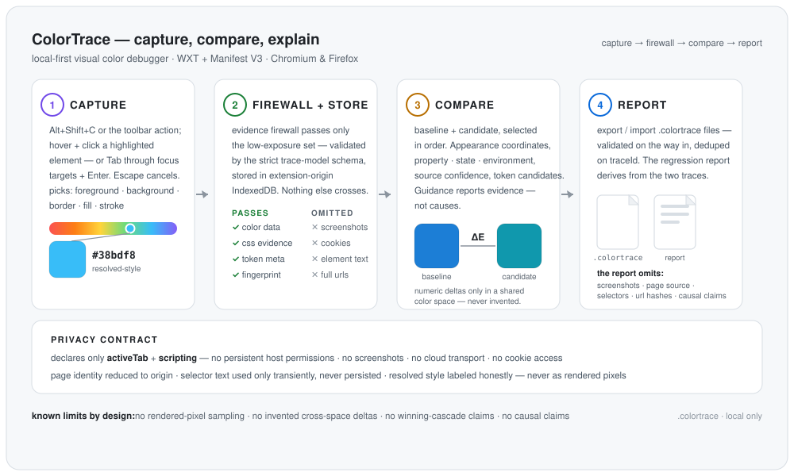

# ColorTrace

ColorTrace is a local-first Visual Color Debugger browser extension for capturing a small, explainable record of color evidence, reopening that evidence later, comparing two traces, reproducing recorded conditions, and exporting a privacy-bounded regression report. Chromium and Firefox builds use WXT and Manifest V3.

  

## Security and privacy contract

The production extension declares only `activeTab` and `scripting`. It has no persistent host permissions, broad all-site access, screenshot/page-capture authority, cookie access, cloud transport, native messaging, or clipboard-read permission. The picker is injected only after an explicit extension action or keyboard command. Persisted traces are validated by the strict `@vcd/trace-model` schema and stored in extension-origin IndexedDB.

ColorTrace intentionally does not persist element text, form values, page source, cookies, screenshots, raw DOM IDs/classes, raw matched CSS selectors, or full page URLs. Page identity is reduced to origin; optional document identity must be a SHA-256 hash. Imported `.colortrace` documents pass through the same strict schema before persistence. Importing a trace whose `traceId` already exists replaces that record instead of creating a duplicate.

Source evidence is selective and bounded. Accessible author CSSOM may contribute observed matching declarations, but selector text is used only transiently for matching and is not retained in the low-exposure trace. Those observations are not promoted into a claim that a declaration won the cascade. CSS custom-property references are token candidates only; ColorTrace does not fabricate semantic token identity. Resolved computed style remains explicitly distinct from rendered-pixel appearance.

See `docs/architecture.md` and `docs/security-model.md` for the detailed boundaries.

## Reproducible build and validation

Run commands from the repository root.

Prerequisites: Node.js 22+ and pnpm 11.17.0. The repository commits `pnpm-lock.yaml`; install with the frozen lockfile.

- `pnpm install --frozen-lockfile`
- `pnpm typecheck`
- `pnpm test`
- `pnpm build:chromium`
- `pnpm smoke:chromium`
- `pnpm build:firefox`
- `pnpm smoke:firefox`
- `pnpm check:manifests`
- `pnpm check` runs typecheck, tests, both production builds, and manifest auditing.

The Chromium smoke loads the actual production extension, invokes its toolbar action through Chrome's extension-debugging protocol so `activeTab` is granted by the same action path as the product, drives the injected picker with browser keyboard events, captures a non-default `background-color` from a deterministic local page, and verifies that the schema-validated trace is persisted and reopenable in the dashboard. It then exports that trace through the real dashboard `.colortrace` action, requires Chromium to complete the Blob/object-URL download without a `downloads` permission, checks the exported low-exposure JSON for the expected bounded evidence and absence of fixture selector identity, clears local history through product UI, imports the exact downloaded file through the native file input, and reloads the dashboard to prove the same trace identity persists exactly once. The local fixture uses no external network service.

Firefox's current WebDriver BiDi `webExtension` module exposes extension install/uninstall but no command for invoking a toolbar action. The Firefox smoke therefore continues to prove production-build installation and extension identity without adding test-only host authority or production hooks. A full Firefox action/picker smoke should be added when the browser automation surface can faithfully generate that extension user gesture.

Development servers are available with `pnpm dev` for Chromium and `pnpm dev:firefox` for Firefox.

## Install a local production build

### Chromium

1. Run `pnpm build:chromium`.
2. Open `chrome://extensions` and enable Developer mode.
3. Choose **Load unpacked**.
4. Select `apps/extension/.output/chrome-mv3` from inside the repository root.
5. Pin ColorTrace if desired, then activate it from the extension action or with `Alt+Shift+C`.

### Firefox

1. Run `pnpm build:firefox`.
2. Open `about:debugging#/runtime/this-firefox` and choose **Load Temporary Add-on**.
3. Select `apps/extension/.output/firefox-mv3/manifest.json` from inside the repository root.
4. Activate ColorTrace from the extension action or with `Alt+Shift+C`.

A temporary Firefox installation lasts until Firefox restarts.

## Build release archives

From the repository root:

- `pnpm package:chromium` creates the Chromium store ZIP.
- `pnpm package:firefox` creates the Firefox extension ZIP plus the Firefox source-review ZIP.
- `pnpm check:packages` verifies that both distributable ZIP manifests preserve ColorTrace's minimal authority and that the Firefox source archive contains the complete reproducible pnpm workspace rather than only `apps/extension`.
- `pnpm check:release-metadata` verifies that generated and packaged Chromium/Firefox manifests use the extension package version and that Firefox uses the stable release ID.

The extension release version has one source of truth: `apps/extension/package.json`. WXT derives both browser manifest versions from that package version. Firefox MV3 packages use the stable signing identity `{4594ab8c-5c7c-5eab-a1b8-fdee041cb882}`; changing that ID would create a different Firefox add-on identity and must not be done as routine release housekeeping.

Release ZIPs are written under `apps/extension/.output/`. The Firefox source archive includes `SOURCE_CODE_REVIEW.md`, the frozen lockfile, workspace definition, extension source, and the local `color-core` and `trace-model` packages required to rebuild the reviewed extension. It intentionally excludes generated `.output`/`.wxt` content and dependencies.

CI additionally extracts that source-review ZIP into a clean directory, performs a fresh frozen-lockfile install there, rebuilds Firefox from the extracted source, and requires every file in the rebuilt `firefox-mv3` tree to match the normal production build byte-for-byte. Missing files, extra files, changed bytes, hidden generated inputs, or undeclared workspace dependencies fail the release gate.

## Product workflow

1. Activate ColorTrace from the extension action or `Alt+Shift+C`.
2. Choose foreground/background/border/fill/stroke evidence as appropriate. Pointer users can hover and click a highlighted element; keyboard users can Tab through page focus targets and press Enter to capture the focused element. Escape cancels.
3. Quick Trace records the browser's resolved computed CSS value. Schema v1 labels that evidence `resolved-style`; it is not a rendered-pixel sample after opacity, blending, filters, gradients, images, or compositing.
4. A successful trace passes through the evidence firewall and strict schema, then is stored only in extension-origin IndexedDB for that browser profile.
5. The dashboard labels resolved-style evidence explicitly and shows bounded source evidence and token candidates without claiming more provenance than was observed.
6. Export or import/reopen `.colortrace` files explicitly. Reopened files are schema-validated before entering local history.
7. Select two traces in order: first is the baseline and second is the candidate. ColorTrace compares recorded appearance coordinates, property/state/environment evidence, source-confidence evidence, and token-candidate changes.
8. Use the reproduction guidance to match recorded baseline conditions. Guidance reports evidence differences; it does not claim a condition caused the visual change.
9. Export a local regression report when needed. The report is derived from the two validated traces and omits screenshots, page source, target selector fingerprints, document URL hashes, and causal attribution.

## Known limitations

ColorTrace does not sample rendered pixels. Canvas/video/cross-origin rendered appearance, screenshots, native eyedroppers, cloud sync, and automatic source-map/token lookup remain intentionally out of scope.

Winning-rule/cascade provenance is incomplete by design. Bounded same-origin/page-accessible CSSOM observations do not cover every nested conditional rule, cascade layer/scope interaction, animation/transition, user-origin rule, or inaccessible/cross-origin stylesheet, and a matching declaration is not asserted to be the winner. Pseudo-class state inference is conservative.

Numeric comparison is currently limited to recorded coordinates that are directly comparable in the same color space/channel shape; ColorTrace does not invent a cross-space delta. HDR/wide-gamut authored provenance is representable in the shared color model, but browser computed-style serialization can constrain what is observed.

---

*Built by [Hans Sai](https://builtbysai.com).*
